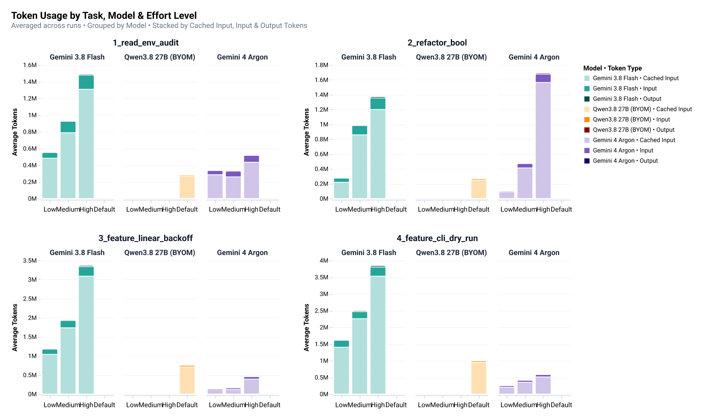
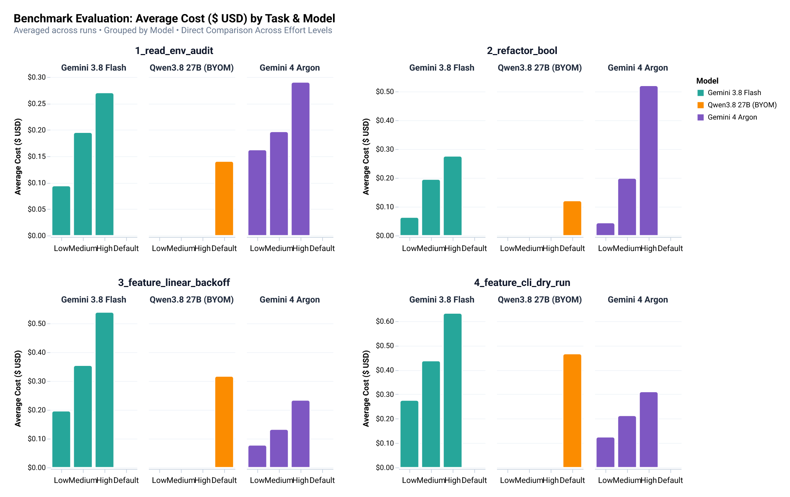
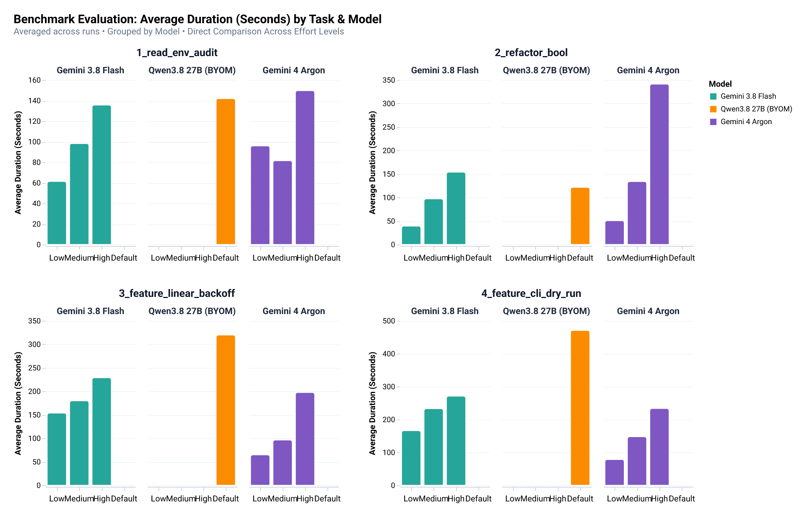

# Antigravity Enterprise Gateway with Open-Weight Models on Google Cloud Run GPU

Connect Antigravity (`agy` CLI, Desktop App, and VS Code extension) to open-weight coding models running on Google Cloud Run GPUs over OpenAI Chat Completions (`wireProtocol: "openai"`). Your client sends one static API key from Secret Manager straight to vLLM. No proxy runs on your laptop and no LiteLLM container runs in Cloud Run.

Model Dockerfiles, Cloud Build pipelines, and Cloud Run GPU presets live in [eggboy/vllm-container-image](https://github.com/eggboy/vllm-container-image).

> [!IMPORTANT]
> **Support scope**: Antigravity clients support `wireProtocol: "openai"` on the Desktop App (`>= 2.15.0`), `agy` CLI (`>= 1.2.15`), and VS Code extension (`JetBrains` and `Zed` use the ACP server, restricted to `genai`). Google supports the Enterprise Gateway for Gemini and Vertex AI models; open-weight models carry no Google support.

## Architecture

```text
Antigravity (agy / Desktop App / VS Code)
  |  HTTPS + Authorization: Bearer <VLLM_API_KEY>
  v
Google Cloud Run GPU (--no-invoker-iam-check, 1x NVIDIA RTX PRO 6000 96 GB)
  |  Secret Manager injects VLLM_API_KEY
  v
vLLM OpenAI Server (/v1/models, /v1/chat/completions)
```

Cloud Run IAM intercepts `Authorization` headers by default and rejects non-Google tokens. `--no-invoker-iam-check` turns that check off at ingress without adding `allUsers` to the IAM policy, so the service stays compatible with organizations that enforce `constraints/iam.allowedPolicyMemberDomains`, as long as `constraints/run.managed.requireInvokerIam` stays unenforced. Inside the container, vLLM leaves `GET /health` open for Cloud Run startup probes and requires `VLLM_API_KEY` on `/v1/*`, answering `HTTP 401` to missing or invalid keys.

## Prerequisites

- **Antigravity client**: `agy` CLI `>= 1.2.15`, Desktop App `>= 2.15.0`, or VS Code extension.
- **Model container image**: Build it into Artifact Registry from [eggboy/vllm-container-image](https://github.com/eggboy/vllm-container-image), for example [`qwen38-27b/Dockerfile.vllm.h100`](https://github.com/eggboy/vllm-container-image/blob/main/qwen38-27b/Dockerfile.vllm.h100) (`Qwen/Qwen3.8-27B-FP8` on `vllm/vllm-openai:v0.32.0`) or [`kat-coder-v2-5-dev/Dockerfile.vllm.a100`](https://github.com/eggboy/vllm-container-image/blob/main/kat-coder-v2-5-dev/Dockerfile.vllm.a100).
- **Cloud Run GPU quota**: Regional `nvidia-rtx-pro-6000` (96 GB) or `nvidia-l4` (24 GB) quota, plus Cloud Run Admin and Secret Manager Admin roles.
- **Ingress policy**: Keep the organization constraint `constraints/run.managed.requireInvokerIam` unenforced (`enforce: false`) so Cloud Run accepts `--no-invoker-iam-check`.

## 1. Store a Static API Key in Secret Manager

Generate a random bearer token, store it in Secret Manager, and grant read access to the runtime service account:

```bash
PROJECT_ID="your-gcp-project-id"
REGION="asia-southeast1"
PROJECT_NUMBER="$(gcloud projects describe "$PROJECT_ID" --format='value(projectNumber)')"
RUNTIME_SA="${PROJECT_NUMBER}-compute@developer.gserviceaccount.com"

gcloud services enable secretmanager.googleapis.com run.googleapis.com --project="$PROJECT_ID"

printf 'sk-vllm-%s' "$(openssl rand -hex 24)" | \
  gcloud secrets create vllm-api-key \
    --project="$PROJECT_ID" \
    --replication-policy="user-managed" \
    --locations="$REGION" \
    --data-file=-

gcloud secrets add-iam-policy-binding vllm-api-key \
  --project="$PROJECT_ID" \
  --member="serviceAccount:${RUNTIME_SA}" \
  --role="roles/secretmanager.secretAccessor"
```

## 2. Deploy the vLLM Image to Cloud Run GPU

Deploy `Qwen3.8-27B-FP8` from your Artifact Registry copy of [eggboy/vllm-container-image](https://github.com/eggboy/vllm-container-image). Run [`GCP/deploy-cloudrun.sh`](https://github.com/eggboy/vllm-container-image/blob/main/GCP/deploy-cloudrun.sh) with `API_KEY_SECRET=vllm-api-key`, or call `gcloud run deploy`:

```bash
IMAGE="${REGION}-docker.pkg.dev/${PROJECT_ID}/vllm/qwen38-27b-vllm:h100"

gcloud run deploy qwen38-27b \
  --project="$PROJECT_ID" \
  --region="$REGION" \
  --image="$IMAGE" \
  --execution-environment=gen2 \
  --gpu=1 \
  --gpu-type=nvidia-rtx-pro-6000 \
  --no-gpu-zonal-redundancy \
  --cpu=20 \
  --memory=80Gi \
  --no-cpu-throttling \
  --port=8000 \
  --timeout=3600 \
  --concurrency=16 \
  --min-instances=0 \
  --max-instances=1 \
  --no-invoker-iam-check \
  --set-secrets="VLLM_API_KEY=vllm-api-key:latest" \
  --startup-probe="httpGet.path=/health,httpGet.port=8000,periodSeconds=30,timeoutSeconds=10,failureThreshold=60" \
  --args="/model/qwen38-27b,--host,0.0.0.0,--port,8000,--tensor-parallel-size,1,--trust-remote-code,--gpu-memory-utilization,0.92,--max-model-len,262144,--dtype,auto,--kv-cache-dtype,fp8,--language-model-only,--enable-prefix-caching,--mamba-cache-mode,align,--enable-chunked-prefill,--max-num-batched-tokens,8384,--performance-mode,interactivity,--enable-auto-tool-choice,--reasoning-parser,qwen3,--tool-call-parser,qwen3_coder,--max-num-seqs,16,--served-model-name,Qwen3.8-27B,--enable-prompt-tokens-details"
```

Cold start from `gcloud run deploy` to `GET /health` `200 OK` took 5.5 minutes in one deployment and 10 minutes in another on `nvidia-rtx-pro-6000`. With `--min-instances=0`, Cloud Run scales idle GPU instances to zero; set `--min-instances=1` to keep a warm GPU during active work.

## 3. Connect Antigravity

Fetch the Cloud Run URL and your static API key once. Client machines then need no Google Cloud credentials and no `gcloud` binary.

### CLI (`agy`) via Environment Variables

```bash
export AGY_LLM_GATEWAY_URL="$(gcloud run services describe qwen38-27b --project="$PROJECT_ID" --region="$REGION" --format='value(status.url)')"
export AGY_LLM_GATEWAY_API_KEY="$(gcloud secrets versions access latest --secret=vllm-api-key --project="$PROJECT_ID")"
export AGY_LLM_GATEWAY_WIRE_PROTOCOL="openai"
# Keep AGY_LLM_GATEWAY_MODELS unset; see Configuration Traps below.

agy models
agy --model Qwen3.8-27B
```

### Desktop App, VS Code, or MDM (`settings.json` / `admin_settings.json`)

Write user settings to `~/.antigravity/settings.json`, or managed settings to `/Library/Application Support/Antigravity/admin_settings.json` on macOS (`/etc/antigravity/admin_settings.json` on Linux, `C:\ProgramData\Antigravity\admin_settings.json` on Windows):

```json
{
  "gateway": {
    "enabled": true,
    "url": "https://qwen38-27b-<PROJECT_NUMBER>.asia-southeast1.run.app",
    "apiKey": "sk-vllm-replace-with-your-secret",
    "wireProtocol": "openai"
  },
  "models": {
    "defaultModelId": "Qwen3.8-27B",
    "list": [
      {
        "modelId": "Qwen3.8-27B",
        "maxTokens": 262144,
        "maxOutputTokens": 65535,
        "supportsThinking": true,
        "thinkingBudget": 8192
      },
      {
        "modelId": "KAT-Coder-V2.5-Dev",
        "maxTokens": 131072,
        "maxOutputTokens": 32768,
        "supportsThinking": true,
        "thinkingBudget": 8192
      }
    ]
  }
}
```

## 4. Tear Down GPU Resources

Delete the Cloud Run service after your session to stop GPU billing. Your container image in Artifact Registry and `vllm-api-key` in Secret Manager stay in place for the next deployment:

```bash
gcloud run services delete qwen38-27b \
  --project="$PROJECT_ID" \
  --region="$REGION" \
  --quiet
```

## 5. Benchmark: Qwen on Cloud Run vs Gemini Effort Tiers

We ran [danistrebel/agy-effort-benchmarks](https://github.com/danistrebel/agy-effort-benchmarks) against this BYOM setup and against the hosted Gemini models in `agy`, on one laptop, with `agy` 1.5.4 and one `google/zx` commit for all runs. The harness hands `agy` four coding tasks inside the zx repo and grades each result with the repo's own tests and diff rules.

| Task | What `agy` has to deliver |
|---|---|
| `1_read_env_audit` | List the `process.env` variables under `src/` in a JSON file without touching source |
| `2_refactor_bool` | Teach `parseBool` to accept `1` and `0`, add tests, rebuild, pass the test |
| `3_feature_linear_backoff` | Add a `linearBackoff` generator with tests and export it from two files |
| `4_feature_cli_dry_run` | Add a `--dry-run` flag to the CLI that prints the command instead of running it |

Configurations:

- Qwen3.8-27B-FP8 on one `nvidia-rtx-pro-6000`, served by vLLM with thinking on (the model default), 3 runs per task.
- Gemini 3.8 Flash and Gemini 4 Argon at low, medium and high effort, 1 run per task. `agy` 1.5.4 lists Argon as `gemini-launch-candidate-{low,medium,high}`.

All 36 runs passed, so the numbers below compare efficiency. Each row sums the per-task means over the four tasks.

| Configuration | Tokens read + written | Output tokens | Cost | Wall clock | Turns |
|---|---|---|---|---|---|
| Gemini 3.8 Flash, low | 3.6M | 10k | $0.63 | 7.0 min | 104 |
| Gemini 3.8 Flash, medium | 6.4M | 70k | $1.18 | 10.2 min | 138 |
| Gemini 3.8 Flash, high | 10.1M | 105k | $1.72 | 13.2 min | 181 |
| Gemini 4 Argon, low | 0.9M | 8k | $0.41 | 4.8 min | 25 |
| Gemini 4 Argon, medium | 1.4M | 17k | $0.74 | 7.7 min | 35 |
| Gemini 4 Argon, high | 3.3M | 41k | $1.35 | 15.4 min | 59 |
| **Qwen3.8-27B on Cloud Run** | **2.3M** | **40k** | **$1.04** | **17.6 min** | **66** |

How to read the table:

- Turns drive tokens. `agy` resends the whole conversation on each turn: a 22k-token system prompt, 15 tool schemas and the history so far. A task that takes 40 turns costs several times a task that takes 10. Qwen needed 66 turns for the four tasks, Argon 25 to 59, Flash 104 to 181.
- Most of those tokens hit a cache. Gemini bills cached input at 5 to 10% of the input price. vLLM's prefix cache served 95% of Qwen's prompt tokens from GPU memory, so the GPU recomputed about 5% of them.
- The two cost columns measure different things. Gemini cost is list price times tokens. Qwen cost is the seconds the Cloud Run instance spent on the task times $3.56 per hour (RTX PRO 6000, 20 vCPU, 80 GiB, asia-southeast1 list price). Cloud Run bills idle seconds at the same rate; the two-hour benchmark session cost about $7.50.
- The $1.04 is the price of running one session alone on the GPU. vLLM's counters show how little of the card that session used: one request in flight at a time (batch size 1) for 88% of wall time, peak KV-cache use of 3.4% of the 1.77M-token budget, against a server cap of 16 concurrent requests. The same GPU can serve 12 to 14 harness sessions at once, each about 1.5× slower, which brings the infrastructure cost per session to about $0.10 for the four tasks.
- Qwen is the slowest configuration. One GPU decodes a 27B model slower than Google's hosted endpoints answer, and output tokens include Qwen's reasoning.
- Qwen has one effort setting. `agy --effort high` fails with `--effort is not supported for model "Qwen3.8-27B"` for gateway models, and `agy` sends no `reasoning_effort` field over the OpenAI wire. vLLM accepts `reasoning_effort` and `chat_template_kwargs.enable_thinking`, so `agy` is the limiting component.



Bar height is the total. Light shades are cached input, dark shades are uncached input, and the thin cap on top is output. The benchmark service ran before we added `--enable-prompt-tokens-details` to the deploy command, so `agy` logged zero cached tokens for Qwen; the split in the chart comes from vLLM's prefix-cache counters, captured before each run.





Caveats: each Gemini tier ran once per task, and single runs swing. Qwen's three runs of `4_feature_cli_dry_run` took 191 s, 892 s and 330 s. Durations include `npm run build:js` and the test suites on the laptop, so they measure the agent loop end to end rather than model latency alone.

To reproduce, run the upstream harness with `--models Qwen3.8-27B` and the `AGY_LLM_GATEWAY_*` variables from section 3 exported. Node 26 needs two fixes: a `node` shim on `PATH` that drops the removed `--experimental-transform-types` flag, and a `node_modules` for the zx checkout installed before the run, because the `agy` sandbox blocks `npm install`.

## Configuration Traps

> [!WARNING]
> **Leave `AGY_LLM_GATEWAY_MODELS` unset for custom model IDs.** Setting `AGY_LLM_GATEWAY_MODELS="Qwen3.8-27B"` routes `agy` (`1.5.2`) through Tier 1 inline model resolution without token metadata. Unknown model IDs resolve `maxMessageTokens` to `0` and abort before network I/O with `serializing trajectory: maxMessageTokens must be positive, got 0`. Omitting `AGY_LLM_GATEWAY_MODELS` triggers Tier 3 discovery (`GET /v1/models`) and populates working token defaults (`max_completion_tokens: 65535`). If you declare `models.list` in `settings.json`, include `maxTokens` and `maxOutputTokens` as shown above.

- **Size `--max-model-len` to `262144` for agent loops.** Running `Qwen3.8-27B` at its native `262144` context window on `nvidia-rtx-pro-6000` (96 GB VRAM, 1.71M FP8 KV-cache token capacity) prevents `HTTP 400` context-overflow errors. With `--enable-prefix-caching --mamba-cache-mode align`, the prefix cache hit 85.6% in an interactive session and 95.2% across the benchmark runs.
- **Match reasoning and tool-call parsers to the model family.** `agy` sends 15 OpenAI tool schemas and reads reasoning deltas from the stream. Pass `--enable-auto-tool-choice --reasoning-parser qwen3 --tool-call-parser qwen3_coder` for `Qwen3.8-27B` and `KAT-Coder-V2.5-Dev` (see [eggboy/vllm-container-image](https://github.com/eggboy/vllm-container-image) for per-model flags).
